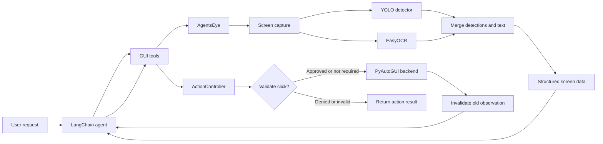

<div align="center">

# 👁️ Agent's EYE

### A screen-aware desktop agent for Windows

**See the interface. Choose one action. Check what happened.**

[](https://www.python.org/)
[](#requirements)
[](LICENSE)
[](#run-the-tests)

Agent's EYE turns a Windows screen into a compact, text-based description an AI
agent can reason about. It combines YOLO interface detection, OCR, and an NVIDIA
NIM language model, then uses guarded desktop controls to carry out one action
at a time.

[Get started](#-get-started) · [How it works](#-how-it-works) ·
[Project guide](#-project-guide) · [Safety & privacy](#-safety--privacy)

</div>

---

## ✨ What it does

- **Reads the screen:** combines object detection and OCR into numbered UI
  elements with text, confidence, coordinates, and a frame ID.
- **Acts through tools:** supports clicking, typing, pressing an allowed key,
  and scrolling using PyAutoGUI.
- **Checks before clicking:** rejects stale observations, missing elements,
  low-confidence detections, and coordinates outside the captured screen.
- **Asks before some consequential clicks:** labels containing configured risky
  words require approval in the terminal.
- **Verifies after actions:** the agent is instructed to take a fresh
  observation and confirm visible results instead of treating a sent action as
  proof of success.
- **Includes a mock desktop:** exercise the controller and tool flow without
  controlling the real mouse or screen.

> [!IMPORTANT]
> The real mode operates on your active desktop. Keep it supervised. The
> safeguards help reduce mistakes; they do not make GUI automation risk-free.

## 📚 Contents

- [Requirements](#-requirements)
- [Get started](#-get-started)
- [Run the agent](#-run-the-agent)
- [Configuration](#️-configuration)
- [How it works](#-how-it-works)
- [Project guide](#-project-guide)
- [Data structures](#-data-structures)
- [Safety & privacy](#-safety--privacy)
- [Tests and debugging](#-tests-and-debugging)
- [Troubleshooting](#-troubleshooting)
- [Dependencies](#-dependencies)
- [License](#-license)

## 🧰 Requirements

- Windows with an interactive desktop session for real screen capture and
  input.
- Python 3.10 or newer.
- An NVIDIA API key for **both real and mock agent conversations**.
- The included `best.pt` weights file for real screen detection.
- Enough disk space and memory for PyTorch, YOLO, and EasyOCR. A compatible
  CUDA setup may be used when available; otherwise the vision components run on
  CPU.

The first startup can take longer while the vision libraries initialize and
EasyOCR obtains its language data. Model loading and performance depend on your
machine and installed PyTorch build.

## 🚀 Get started

Open PowerShell in the project directory, then create and activate a virtual
environment:

```powershell
py -m venv .venv
.\.venv\Scripts\Activate.ps1
python -m pip install --upgrade pip
python -m pip install -r requirements.txt
```

Provide your NVIDIA API key in the current PowerShell session:

```powershell
$env:NVIDIA_API_KEY = "your-nvidia-api-key"
```

The key is read from the environment when the application starts. Do not put
real credentials in source files, README examples, screenshots, or commits.
Closing the PowerShell session clears this session-scoped variable.

> **PowerShell activation note:** If script execution is restricted by your
> machine's policy, open a permitted PowerShell session or use the virtual
> environment's interpreter directly, for example
> `.\.venv\Scripts\python.exe -m pip install -r requirements.txt`.

## ▶️ Run the agent

### Real desktop mode

With `NVIDIA_API_KEY` set and `best.pt` present in the project root:

```powershell
python agent.py
```

The agent displays a `You:` prompt. Enter a request, supervise the actions, and
type `exit` or `quit` to leave. `Ctrl+C` or end-of-input also exits the
conversation loop. The mouse-to-corner PyAutoGUI fail-safe is enabled as an
emergency stop.

### Mock mode

Mock mode runs the same language-model conversation against a small simulated
search page instead of capturing or controlling the real desktop:

```powershell
$env:EYE_MODE = "mock"
python agent.py
```

Mock mode still contacts NVIDIA's configured service and requires
`NVIDIA_API_KEY`; it is **not** an offline language-model mode. The environment
setting lasts only for the current PowerShell session. Return to the real
backend with:

```powershell
$env:EYE_MODE = "real"
```

## ⚙️ Configuration

| Environment variable | Default | Purpose |
| --- | --- | --- |
| `NVIDIA_API_KEY` | *(required)* | Credential passed to the NVIDIA chat model client. Startup fails with a clear error if it is missing or blank. |
| `EYE_MODE` | `real` | `mock` selects the simulated eye/backend; any other value selects the real desktop implementation. |
| `AGENT_MAX_STEPS` | `60` | LangChain recursion limit for one streamed agent turn. Must be parseable as an integer. |
| `AGENT_THINKING` | `1` | Enables the model's thinking option only when the value is exactly `1`. |

The NVIDIA model is currently selected in `agent.py` as
`nvidia/nemotron-3-ultra-550b-a55b`. Screen-capture, OCR, and detector tuning
defaults are defined by `EyeConfig` in `agents_eye/eye.py`; they are currently
configured in Python rather than through environment variables.

## 🧠 How it works



The conversation follows an **observe → decide → act → observe** loop:

1. `observe_screen` captures the current display and returns a numbered
   description. Screen text is wrapped in `<screen_data>` tags.
2. The language model chooses a tool and bases it on the current observation.
3. `ActionController` checks clicks against the latest frame and applies the
   action through the selected backend.
4. The controller invalidates the observation after every action. A click
   therefore cannot be repeated against an old frame.
5. The agent observes again. `verify_text` performs a fresh observation and
   reports visible matching text.

Text and coordinates are model inputs, not a direct image stream: the vision
pipeline runs locally and the tool results (which may include text read from
the screen) are sent as part of the model conversation. OCR can be imperfect,
and an element's detection confidence is not a guarantee that clicking it is
safe or correct.

## 🗂️ Project guide

### Application and desktop control

| File | Responsibility |
| --- | --- |
| [`agent.py`](agent.py) | Application entry point. Defines the model instructions, reads environment settings, builds the real or mock eye/backend, initializes the tools and NVIDIA model, and runs the interactive streaming chat loop. |
| [`controller.py`](controller.py) | Action safety and execution. `ActionController` validates clicks, checks confidence and bounds, requests approval for matching risky labels, limits text length, restricts keys, clamps scroll input, and invalidates observations. `PyAutoGUIBackend` implements real mouse/keyboard/scroll operations and enables the corner fail-safe. |
| [`gui_tools.py`](gui_tools.py) | LangChain tool definitions exposed to the model: observe, find, click, type, press a key, scroll, and verify visible text. It formats observations and tags screen-derived output as untrusted data. |
| [`eye_interface.py`](eye_interface.py) | Defines the lightweight eye/backend contract used in tests. `MockEye` simulates a search page; `MockBackend` changes that simulated page in response to actions. |

### Vision package: `agents_eye/`

| File | Responsibility |
| --- | --- |
| [`agents_eye/__init__.py`](agents_eye/__init__.py) | Exposes the lightweight data structures without importing the heavy vision stack, so modules such as tests can import schema types without loading PyTorch. |
| [`agents_eye/eye.py`](agents_eye/eye.py) | Main real-screen implementation. Configures DPI awareness, finds and loads model weights, selects CPU or CUDA, captures the configured monitor, runs detection/OCR, caches unchanged screens, manages frame IDs and invalidation, and offers text-search and debug-image helpers. |
| [`agents_eye/detector.py`](agents_eye/detector.py) | Wraps Ultralytics YOLO. Loads the supplied weights and converts model output into `Detection` records. It also includes a local-path workaround for Ultralytics when a path contains an apostrophe. |
| [`agents_eye/ocr.py`](agents_eye/ocr.py) | Wraps EasyOCR. Reads text from a screen image, optionally downsizes wide frames for speed, filters low-confidence or empty results, and rescales text boxes back to the original frame coordinates. |
| [`agents_eye/merge.py`](agents_eye/merge.py) | Combines YOLO boxes and OCR text. Assigns text to the smallest containing detection when possible, keeps unmatched text as its own element, orders results visually, and assigns element IDs. |
| [`agents_eye/schema.py`](agents_eye/schema.py) | Defines the data records shared by the vision pipeline: `Element`, `ScreenState`, `Detection`, and `TextBox`. |
| [`agents_eye/eye_debug.py`](agents_eye/eye_debug.py) | Diagnostic script: observes the screen twice, prints element details, draws detection boxes over the latest capture, and saves `eye_debug.png`. |

### Weights, tests, and project metadata

| File | Responsibility |
| --- | --- |
| [`best.pt`](best.pt) | YOLO model weights loaded by the real eye. Keep the file alongside the project root unless you change `EyeConfig.model_path`. |
| [`test_controller.py`](test_controller.py) | Tests controller checks and the mock search flow, plus required NVIDIA API-key behavior. |
| [`test_gui_tools.py`](test_gui_tools.py) | Tests that text returned by `verify_text` is marked as untrusted screen data. |
| [`requirements.txt`](requirements.txt) | Runtime Python dependencies. |
| [`requirements-dev.txt`](requirements-dev.txt) | Development dependencies; includes the runtime requirements and pytest. |
| [`.gitignore`](.gitignore) | Excludes Python caches, virtual environments, local environment files, test/build output, and debug output from Git. |
| [`LICENSE`](LICENSE) | MIT license for the project source. A third-party dependency or model file can have separate terms. |

### Tool reference

| Tool | Input | What it returns or does |
| --- | --- | --- |
| `observe_screen` | None | Captures/observes the screen and returns up to 60 numbered elements with the frame ID, screen size, labels, text, confidence, and center coordinates. |
| `find_element` | `query` | Searches the latest observation for up to five elements whose text contains the query. It does not take a new observation. |
| `click_element` | `element_id`, `frame_id` | Asks the controller to validate and click an element from the specified latest frame. |
| `type_text` | `text` | Types into the currently focused field; accepts non-empty text up to 500 characters. It does not click or focus a field for you. |
| `press_key` | `key` | Presses one permitted key: `enter`, `tab`, `esc`, `backspace`, arrows, `pageup`, `pagedown`, `home`, `end`, `win`, or `space`. Key combinations are not allowed. |
| `scroll` | `amount` | Clamps the requested amount to -20…20 before passing it to the backend. In the real backend, each unit is multiplied by 100 for PyAutoGUI. |
| `verify_text` | `text` | Takes a fresh observation and reports up to three visible text matches. This checks detected text presence, not whether an action achieved a broader goal. |

## 🧩 Data structures

- **`Element`** represents one detected or OCR-only screen item. It includes
  an integer ID, type/label, recognized text, bounding box, confidence, and a
  computed center point. Coordinates are in screen pixels.
- **`ScreenState`** represents one observation. Its frame ID changes with each
  observation, even when previously detected elements are reused from cache.
  It also carries screen dimensions, elements, capture timing/cache metadata,
  and monitor offsets.
- **`Detection`** represents one raw detector result in captured-frame
  coordinates: bounding box, confidence, and class label.
- **`TextBox`** represents one raw OCR result in captured-frame coordinates:
  bounding box, recognized text, and OCR confidence.

The merge step applies the monitor's left/top offsets to output element boxes so
that their centers can be used as desktop click coordinates.

## 🛡️ Safety & privacy

- **Supervise every run.** The real backend can click, type, press keys, and
  scroll in the active desktop session.
- **Use the emergency stop.** PyAutoGUI's fail-safe is enabled; move the pointer
  to a screen corner to trigger it.
- **Review approvals.** Click labels containing any of `delete`, `remove`,
  `pay`, `buy`, `purchase`, `uninstall`, `format`, `shutdown`, `send`, or
  `confirm order` trigger a terminal confirmation prompt. This is a simple
  text match, not a complete classification of dangerous actions. Typing and
  key presses do not use this approval check.
- **Treat screen text as untrusted.** Page content may contain instructions or
  misleading text. The model instructions say to treat `<screen_data>` as data,
  never as authority. This is a prompt-level defense, not a security boundary.
- **Protect sensitive screens.** Although the captured image is processed
  locally, recognized screen text and tool results are included in the
  conversation sent to the NVIDIA model endpoint. Review the endpoint's data
  handling terms before using the agent on private information.
- **Never supply credentials casually.** The model instructions prohibit
  typing passwords, keys, or personal data unless the user explicitly provided
  them for that task. Prefer not to automate credential entry.
- **Understand verification limits.** An `ok: true` result only means the
  action was sent. Text matching can fail due to OCR errors and cannot prove
  hidden state or a real-world outcome.

## 🧪 Tests and debugging

Install development requirements and run the suite:

```powershell
python -m pip install -r requirements-dev.txt
python -m pytest -q
```

The tests use the mock eye/backend and do not need `best.pt`, an NVIDIA key,
screen-capture permissions, or a real desktop interaction.

To run the screen diagnostic in real mode:

```powershell
python -m agents_eye.eye_debug
```

It requires the vision dependencies, `best.pt`, and a usable desktop session.
The script prints the detected elements and writes an annotated image named
`eye_debug.png` in the current directory; that generated image is ignored by
Git.

## 🔧 Troubleshooting

| Symptom | Things to check |
| --- | --- |
| `NVIDIA_API_KEY is required` | Set `$env:NVIDIA_API_KEY` in the PowerShell session before running `python agent.py`. Mock mode still needs the key. |
| `YOLO model weights not found` | Confirm `best.pt` exists in the project root, or adjust the `EyeConfig.model_path` used by the real eye. |
| A click reports `NO_FRESH_OBSERVATION` | Call `observe_screen` after the previous action, then use the element ID and frame ID from that new result. |
| A click reports `STALE_FRAME` | The screen was observed again or changed. Re-observe and select the target from the newest frame. |
| A click reports `LOW_CONFIDENCE` or `OUT_OF_BOUNDS` | Re-observe, check the label/coordinates, and avoid forcing a click on an uncertain detection. |
| The model cannot read an element | Check that the target is visible, try a fresh observation, and remember OCR/detection may miss small, low-contrast, or unusual content. |
| Real mode is slow or runs out of memory | Vision inference may be running on CPU. Check the installed PyTorch/CUDA compatibility and the machine's available resources. |
| Mock mode does not interact with Windows | That is expected: it only updates the simulated search screen. Choose real mode for desktop interaction. |

## 📦 Dependencies

| Package | Used for |
| --- | --- |
| `langchain` | Agent orchestration and streaming tool-use loop. |
| `langchain-nvidia-ai-endpoints` | NVIDIA chat model integration. |
| `ultralytics` | YOLO model loading and object detection. |
| `easyocr` | Text recognition from captured frames. |
| `torch` | Tensor runtime used by the vision libraries; install a PyTorch build appropriate for CPU or the machine's CUDA setup if the dependency resolver does not choose the desired one. |
| `opencv-python` | Frame conversion, resizing, image comparison, and debug annotation. |
| `numpy` | Image arrays and detector-output handling. |
| `mss` | Desktop screenshot capture. |
| `pyautogui` | Real desktop mouse, keyboard, and scroll control. |
| `pytest` | Development/test dependency from `requirements-dev.txt`. |

## 📄 License

The project source is distributed under the [MIT License](LICENSE). Dependencies
and model weights may have additional terms; check their respective licenses
before redistributing or using them.

---

<div align="center">

Built for careful, observable desktop automation.

</div>
